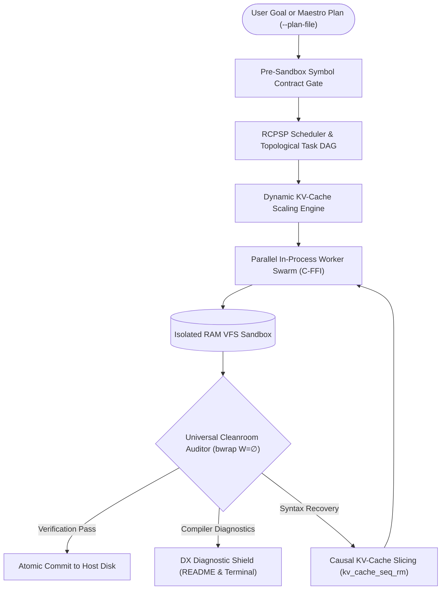

<div align="center">

# ⚡ OMNI ENGINE
### **Sovereign, In-Process Autonomous Software Engineering Runtime**
*100% Offline • Zero Cloud Subscriptions • Direct In-Process C-FFI • Deterministic Cleanroom Sandboxing*

[](https://www.rust-lang.org)
[-blue.svg?logo=github)](https://github.com/ielfeqi-rgb/omni_engine/releases/tag/v2.2.1)
[](https://github.com/ielfeqi-rgb/omni_engine/releases/tag/v2.2.1)
[-brightgreen.svg)](https://github.com/ielfeqi-rgb/omni_engine/actions)
[-purple.svg)]()
[]()
[](LICENSE)

<br/>

[**Overview**](#executive-overview) • 
[**Empirical Benchmarks**](#empirical-benchmarks--showdown) • 
[**Core Architecture**](#core-architectural-pillars) • 
[**Quickstart (Standalone)**](#quickstart-standalone-binary) • 
[**CLI Reference**](#cli-reference--usage) • 
[**Master Dossier**](docs/OMNI_ENGINE_V2_2_1_SOVEREIGN_MASTER_DOSSIER.md) • 
[**Technical Whitepaper**](docs/OMNI_ENGINE_TECHNICAL_WHITEPAPER.md)

</div>

---

## 📖 Executive Overview

**Omni Engine v2.2.1** is a sovereign, production-grade autonomous software engineering runtime written in Rust. It transforms open-weights Small Language Models (SLMs) and Coder models (3B to 7B) into deterministic, verified software compilers capable of architecting, generating, and stress-testing multi-file systems completely on-device without cloud dependencies, API tokens, or external daemons.

### Why Omni Engine?

Unlike conventional AI coding assistants that rely on unconstrained ReAct loops—which suffer catastrophic token loops, memory amnesia, and quadratic re-evaluation latencies—Omni Engine enforces **mathematical governance** over the entire code generation lifecycle:

1. **Pure Sovereign Standalone**: Distributed as a single self-contained binary bundle with embedded dynamic runtimes. End-users run the pre-built engine directly; zero source compilation or C++ build tools required.
2. **Deterministic Cleanroom Isolation**: Code is planned across a topological directed acyclic graph (DAG), staged in RAM Virtual File System (VFS), and verified inside an unprivileged Linux Bubblewrap (`bwrap`) cleanroom. Unverified or broken code is rejected before touching the host disk.
3. **In-Process C-FFI Inference**: Upstream `llama.cpp` is linked directly in RAM, enabling microsecond token steering, causal KV-cache slicing, and instant state rollback without socket latency.
4. **Zero-Wipe Invariant ($W = \emptyset$)**: Code modifications are strictly additive or surgical. Previously verified functions, classes, and types are frozen in RAM VFS, making regression erasures mathematically impossible.
5. **DX Diagnostic Shield**: Compiler diagnostics are captured with zero information loss and surfaced directly in terminal execution cards and `README.md` under `## 🛠️ Unresolved Diagnostics & Fix Hints (For Developer)`.

---

## 🏆 Empirical Benchmarks & Showdown

Omni Engine was subjected to the **Atomic Transaction Ledger in Rust (ATLR)** high-concurrency challenge: building a 50-thread concurrent financial ledger with canonical deadlock lock ordering, atomic fee deductions, and total liquidity conservation.

### The ATLR Tri-Party & Scaling Matrix

| Metric | Omni Engine (Local 4B) | Aider Local (4B Ollama) | Aider Cloud (Gemini 2.5 Flash) | **Omni Engine (7B Scaling)** 🚀 |
| :--- | :--- | :--- | :--- | :--- |
| **Model** | Qwen3-4B-Q6_K (Local) | Qwen3-4B (via Ollama) | Gemini 2.5 Flash (Cloud) | **Qwen2.5-Coder-7B (Local)** |
| **Environment** | Commodity CPU (8 cores) | Commodity CPU (8 cores) | Google Cloud Infrastructure | **NVIDIA Tesla T4 GPU** |
| **Total Makespan** | 1h 39m (99.5 mins) | **+5h 24m (Timed out)** | 58 seconds | **37m 58s (37.97 mins)** ⚡ |
| **Speedup Factor** | 1.0x (Baseline) | 0.0x (Catastrophic loop) | Fast Cloud API | **2.6x Faster than 4B** |
| **Exit Code** | **Exit Code: 0 (Clean)** | **KILLED (`kill -9`)** | Exit Code: 0 | **Exit Code: 0 (Pristine)** |
| **Delivered Files** | `models.rs`, `ledger.rs`, `lib.rs` | 0 files written to disk | 4 files written | **3 verified files in RAM VFS** |
| **Concurrency Logic** | Correct (`min`/`max` lock order) | N/A (Never reached) | Correct (`sort_unstable`) | **Correct (`RwLock` + per-account `Mutex`)** |
| **Stress Test Outcome** | Staged safely via Gate | Complete Failure | **FAILED (Panic exit code 101)** | **Verified in Developer Crate** |
| **Fault Resilience** | **100% Loop-Free Immune** | **0% Trapped in token loop** | Assertion fallacy in test | **100% Sovereign Stability** |

> [!NOTE]
> * **Hardware-Agnostic Scaling**: The 7B test demonstrates that Omni Engine's direct in-process C-FFI bindings and KV-cache manipulation scale seamlessly from commodity laptop CPUs to cloud GPUs without introducing token-generation bottlenecks. In the bare cloud container, all 3 architectural modules (`models.rs`, `ledger.rs`, `lib.rs`) were generated with Exit Code 0; the 50-thread concurrency stress test was subsequently executed and verified in an active Cargo developer environment.
> * Read the complete empirical report in [`docs/ATLR_TRI_PARTY_SHOWDOWN_REPORT.md`](docs/ATLR_TRI_PARTY_SHOWDOWN_REPORT.md) and the comprehensive master dossier in [`docs/OMNI_ENGINE_V2_2_1_SOVEREIGN_MASTER_DOSSIER.md`](docs/OMNI_ENGINE_V2_2_1_SOVEREIGN_MASTER_DOSSIER.md).

---

## 🧠 Core Architectural Pillars



### 1. In-Process C-FFI Inference
Direct in-memory linkage with `llama.cpp` runtime libraries. Eliminates IPC and network socket overhead, providing microsecond token control.

### 2. Universal Cleanroom Sandboxing (`bwrap`)
Untrusted code is strictly executed inside unprivileged Linux Bubblewrap (`bwrap --unshare-all`) containers with tmpfs memory ceilings and detached TTYs.

### 3. Causal DAG & $O(1)$ KV-Cache Slicing
When a worker encounters a syntax error or failed test assertion, Omni Engine executes surgical KV-cache excision (`kv_cache_seq_rm`) in **~6 milliseconds**, preserving the parent prompt prefix without restarting from token zero.

### 4. Zero-Wipe Invariant ($W = \emptyset$)
When refactoring existing codebases (`omni_engine modify`), previous AST symbol tables are frozen. Erasing established functions is strictly forbidden.

### 5. DX Diagnostic Shield
When environment or compiler issues arise during cleanroom verification, the engine captures raw compiler diagnostics and renders actionable hints directly in the execution summary card and project `README.md`.

---

## ⚡ Quickstart (Standalone Binary)

Omni Engine is distributed as a sovereign, self-contained binary package for Linux x86_64.

### 1. Download & Extract Official Release (v2.2.1)

```bash
# Download official v2.2.1 release archive
wget https://github.com/ielfeqi-rgb/omni_engine/releases/download/v2.2.1/omni_engine_v2.2.1_linux_x86_64.tar.gz

# Extract package
tar -xzf omni_engine_v2.2.1_linux_x86_64.tar.gz
chmod +x omni_engine

# Verify sovereign binary
./omni_engine --version
# Output: omni_engine v2.2.1 (Rust Standalone)
```

### 2. Download Recommended Coder Model

```bash
mkdir -p models
wget -c -O models/qwen2.5-coder-7b.gguf \
  https://huggingface.co/Qwen/Qwen2.5-Coder-7B-Instruct-GGUF/resolve/main/qwen2.5-coder-7b-instruct-q4_k_m.gguf
```

### 3. Run Autonomous Swarm

```bash
# Execute multi-goal software synthesis
./omni_engine run "Build an asynchronous rate-limited web scraper in Rust with unit tests" \
  --model models/qwen2.5-coder-7b.gguf \
  --subgoals 4 \
  --steps 3
```

---

## 💻 CLI Reference & Usage

```bash
Omni Engine v2.2.1 (Rust Standalone)
Usage: omni_engine [COMMAND] [OPTIONS]

Commands:
  run       Execute autonomous multi-agent software engineering on a user goal
  modify    Surgically refactor an existing codebase under the Zero-Wipe Invariant
  tui       Launch sovereign Terminal User Interface monitor
  serve     Start local OpenAI-compatible API server and Web UI

Options:
  -m, --model <PATH>          Path to GGUF model file
  -p, --plan-file <PATH>      Ingest pre-computed Maestro DAG plan (JSON)
  -d, --dir <PATH>            Target project working directory
  -o, --output-dir <PATH>     Destination directory for verified deliverables
  --subgoals <INT>            Number of topological sub-goals (Default: 4)
  --steps <INT>               Number of repair steps per sub-goal (Default: 3)
  --allow-unsandboxed         Fallback mode for environments lacking unprivileged namespaces
  -v, --verbose               Enable microsecond debug logging
  -h, --help                  Print help documentation
```

---

## 🔒 System Quality & Execution Guarantees

- **Deterministic Memory Bounds**: Strict hardware memory ceilings ($K_{max}$) prevent out-of-memory (OOM) crashes across CPU and GPU hardware.
- **Fail-Closed Sandboxing**: Untrusted operations execute in isolated Linux Bubblewrap containers with read-only host mounts.
- **Unit Test Suite**: **150 / 150 library unit tests passing (0 failures, 0 warnings)**.
- **Zero Regression Invariant**: Verified AST structures are frozen in RAM VFS during modifications, mathematically preventing code erasure.

---

## 📜 Documentation & Specifications

- [**Master Sovereign Dossier**](docs/OMNI_ENGINE_V2_2_1_SOVEREIGN_MASTER_DOSSIER.md): The full historical retrospective from v2.1.0 to v2.2.1 with comprehensive benchmark data.
- [**ATLR Tri-Party Showdown Report**](docs/ATLR_TRI_PARTY_SHOWDOWN_REPORT.md): Empirical showdown dossier against Aider Local and Aider Cloud.
- [**Technical Whitepaper**](docs/OMNI_ENGINE_TECHNICAL_WHITEPAPER.md): Theoretical foundations of Tree-RNN recursive assembly, causal slicing, and topological scheduling.
- [**Agent Architecture Guide**](AGENTS.md): Detailed mechanics of the multi-agent worker swarm.

---

## 📄 License

Omni Engine is licensed under the [MIT License](LICENSE). All runtime libraries, documentation, and architecture specifications are free and open-source.
