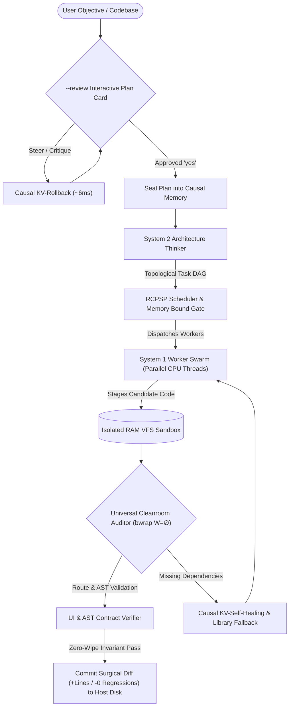

<div align="center">

# ⚡ OMNI ENGINE
### **The Sovereign, In-Process Autonomous Software Engineering Runtime**
*100% Offline • Zero Cloud Subscriptions • Direct In-Process C-FFI • Zero-GPU Commodity 8GB Laptop Baseline*

[](https://www.rust-lang.org)
[](https://github.com/ielfeqi-rgb/omni_engine)
[]()
[-purple.svg)]()
[]()
[](LICENSE)

<br/>

[**Quickstart**](#-quickstart-in-60-seconds) • 
[**The Paradigm Shift**](#-the-core-paradigm-shift-task-completion-vs-typing-speed) • 
[**The 7 Pillars**](#-the-7-sovereign-architectural-pillars) • 
[**CLI Reference**](#-cli-reference--command-suite) • 
[**OpenAI API & Web UI**](#-openai-compatible-api--web-ui-dashboard) • 
[**🤖 AI Agent Guide (AGENTS.md)**](AGENTS.md)

</div>

---

## 🎯 The Core Paradigm Shift: Task Completion vs. Typing Speed

Most AI coding assistants rely on massive remote cloud clusters (Claude 3.5 Sonnet, GPT-4o, Cursor). While they stream text at high speeds (**50–70 tok/s**), they create a hidden productivity trap:

1. **The Cloud Chatbot Trap (Vanity Typing Speed):**  
   The cloud chatbot types fast, but outputs incomplete snippets. The software developer spends the next **30 to 60 minutes** manually copying code between files, resolving missing packages, fixing broken imports, and hunting down regressions where the LLM erased previously working functions.
2. **The Omni Engine Reality (End-to-End Autonomous Delivery):**  
   Omni Engine runs locally on your laptop's CPU at a steady, deliberate pace (**2.5 to 3.8 tok/s** on 1.5B; **1.9 to 2.3 tok/s** on 4B). But it operates as an **autonomous software compiler swarm**:
   * It analyzes dependencies and displays an interactive plan card for your approval (`--review`).
   * It dispatches parallel workers in an isolated in-memory RAM Virtual File System (VFS).
   * It catches missing libraries and automatically heals or falls back to the standard library.
   * It executes the code in a deterministic Linux Bubblewrap sandbox to audit syntax and routes.
   * **Result:** In **3 to 5 minutes**, a full-stack, tested, multi-file software system is delivered directly to your disk with **zero human glue work** and **zero regression wipes**.

> **The Metric that Matters:** *Speed is not how fast an LLM prints tokens on a screen. Speed is how many minutes elapse between user intent and tested, running software committed to disk.*

---

## 💻 The 8GB Commodity Laptop Feat & Hardware Multiplier

* **The 8GB Baseline Engineering Feat:**  
  Omni Engine is the first autonomous multi-agent coding runtime capable of executing full-lifecycle multi-file software engineering locally on a standard, commodity laptop with **8GB RAM and pure CPU (Zero-GPU)**.
  * **Model Weights (1.5B Q4_K_M):** ~1.14 GB RAM
  * **In-Process Compute Buffer:** ~314 MB RAM
  * **Causal KV-Cache Context (4,096 tokens):** ~395 MB RAM
  * **Peak RSS Memory Footprint:** **`1.87 GB Total`**
  * **Swap Disk Paging Activity:** **`0 MB (Zero Paging)`**
* **Hardware as a Cheap Multiplier, Architecture as the Moat:**  
  If you run Omni Engine on a machine with an entry-level GPU (e.g. RTX 3050) or Apple Silicon (M-series), throughput immediately jumps by **10x to 15x (35 to 50 tok/s)** via our built-in dynamic C-FFI backend without changing a single line of Rust code.
  * *Conversely, even an H100 cluster ($300,000) cannot protect naive LLMs from catastrophic code wiping, multi-file context hallucinations, or context crashes without Omni Engine's deterministic VFS and Causal Rollback architecture.*

---

## 🧠 The 7 Sovereign Architectural Pillars



### 1. Direct In-Process C-FFI Inference (`llama.cpp`)
Omni Engine eliminates the latency, serialization, and socket overhead of Python wrappers or external server daemons. `llama.cpp` is deeply embedded into the compiled Rust binary via direct C foreign-function interfaces (`c_bridge`), providing microsecond execution and thread-safe context control.

### 2. The Zero-Wipe Invariant (`omni_engine modify`)
When prompted to modify or refactor existing software, standard LLMs suffer from the **Blank Slate Fallacy**—they delete existing functions and re-invent the file from scratch. Omni Engine preloads the existing repository into RAM VFS and enforces the physical **Zero-Wipe Invariant**: the Tree-Sitter AST symbol table is locked, and only surgical line diffs (`+lines / -0 regressions`) are accepted.

### 3. Causal DAG & $O(1)$ KV-Cache Slicing
When a worker encounters a syntax error or a hallucinated import, conventional tools wipe context and restart from token 0. Omni Engine maps execution steps in a Causal DAG and executes atomic KV-cache slicing (`kv_cache_seq_rm`), excising unapproved tokens in **~6.1 milliseconds** without re-prompting or losing valid prior context.

### 4. Causal KV Turn-Sealing for Reasoning Models
Modern reasoning models (such as DeepSeek-R1 and Qwen3) generate thousands of internal thinking tokens inside `<think>` tags, rapidly exhausting context windows. Omni Engine's **Turn-Sealing** algorithm surgically strips transient reasoning tokens upon completion and seals the cache with native End-of-Turn tokens, reclaiming **+3,800 free tokens** in RAM.

### 5. Interactive Human-in-the-Loop Steering (`--review`)
Omni Engine enforces sovereign governance: with `--review`, the Thinker renders an architectural plan card detailing targeted files and subgoals before any worker writes code. If the user critiques the plan (e.g., `no add priority levels and json export`), the engine executes **Causal KV-Rollback**, excises the unapproved plan draft, re-plans with user constraints, and seals the memory upon user approval (`yes`).

### 6. Isolated RAM VFS & Linux Cleanroom Sandbox
Candidate code never touches the physical host disk until verified. All file operations occur in memory (`MemoryVfs`) inside a hardened Linux Bubblewrap container (`bwrap --unshare-all`). Tests audit syntax, simulate user interactive stdin, and verify frontend-backend route alignments in a read-only environment.

### 7. $O(1)$ Context Isolation Engine (50+ Files / 50K Lines)
Omni Engine scales to large repositories without blowing context budgets. Via `distill_interface_contract`, large dependency files (2,000+ lines) are distilled into concise 25-line interface contracts containing only public type signatures and API schemas. Worker attention remains fixed between **1,500 and 2,500 tokens** regardless of repository size.

---

## 📊 Live Empirical Proof: The Two-Turn Challenge

In an empirical benchmark using `Qwen2.5-Coder-1.5B` (1.1 GB model) on a standard CPU workstation:

* **Turn 1: Full-Stack Project Creation with Interactive Steering (`workspace/task_tracker/`)**
  * User rejected initial plan: `no add priority levels and json export`.
  * Engine executed Causal KV-Rollback, synthesized Plan v2, and sealed memory upon `yes`.
  * Cleanroom caught missing `tabulate` library; worker automatically healed and fell back to standard libraries without crashing.
  * Delivered modular system: `models.py` (1,927 B), `repository.py` (756 B), `cli.py` (1,161 B).
* **Turn 2: Cross-Cutting Multi-File Modification with Zero-Wipe Invariant**
  * Commanded engine to add priority filtering and JSON export across all files simultaneously.
  * Workers executed in parallel at sustained **2.6 to 3.4 tok/s**.
  * **Verified Line Diffs:**
    * `models.py`: patched `+7 / -5 lines` (added priority enum). **7/7 existing functions preserved (100%)**.
    * `repository.py`: patched `+12 / -0 lines` (added filtering/export). **7/7 existing functions preserved (100%)**.
    * `cli.py`: patched `+15 / -0 lines` (added CLI commands). **6/6 existing functions preserved (100%)**.
  * **Compiler Verification:** `python3 -m py_compile` passed with **0 syntax errors**.

---

## 🚀 Quickstart in 60 Seconds

### Prerequisites (Linux x86_64)
- **Rust Toolchain:** `curl --proto '=https' --tlsv1.2 -sSf https://sh.rustup.rs | sh`
- **Compiler & Build Tools:** `sudo apt install build-essential cmake clang bubblewrap` (or `sudo dnf install ...`)
- **Upstream llama.cpp Libraries:** Verified against `v0.6.0-dev (build 11429)` (see [REQUIREMENTS.md](REQUIREMENTS.md))

### 1. Build from Source
```bash
git clone https://github.com/ielfeqi-rgb/omni_engine.git
cd omni_engine
cargo build --release
```

### 2. Download Recommended Coding Model (~1.1 GB)
Omni Engine features a native high-speed model downloader with live animated progress bars:
```bash
./target/release/omni_engine download --qwen
# Or download custom GGUF models directly from HuggingFace / HTTP:
# ./target/release/omni_engine download https://huggingface.co/.../model.gguf
```

### 3. Launch the Sovereign TUI Dashboard
```bash
./run_tui.sh
# or directly:
./target/release/omni_engine tui
```

---

## 🛠️ CLI Reference & Command Suite

Omni Engine provides symmetric control across terminal commands, interactive shells, and autonomous swarms:

```bash
# --- Autonomous Project Generation ---
# Build a complete project from scratch with human plan review:
omni_engine run "Build a modular Task Tracker in Python with SQLite" --review --output-dir ./task_tracker

# Headless generation with auto-approved dependencies (ideal for scripts & CI):
omni_engine run "Build an AES-256 CLI tool in Rust" -y --output-dir ./aes_tool

# --- Incremental Codebase Modification (Zero-Wipe) ---
# Safely refactor or extend an existing codebase without deleting old logic:
omni_engine modify "Add priority levels and JSON export" --dir ./task_tracker --output-dir ./task_tracker --review

# --- Model Management & User Interfaces ---
omni_engine download --qwen   # Stream & verify GGUF models directly with progress bar
omni_engine models           # List discovered GGUF models and memory requirements
omni_engine tui              # Full-screen graphical Terminal Dashboard (Ratatui)
omni_engine console          # Interactive console REPL shell (omni❯)
omni_engine chat             # Direct in-process conversational C-FFI dialogue
omni_engine serve            # Launch Web UI and OpenAI HTTP proxy server

# --- System Diagnostics & Hardware Telemetry ---
omni_engine status           # View CPU threads, RAM RSS buffer, and zero-swap activity
omni_engine kv-test          # Run physical in-process KV-cache surgical manipulation test
omni_engine causal-test      # Run live Causal DAG self-healing hardware benchmark
```

---

## 🌐 OpenAI-Compatible API & Web UI Dashboard

Omni Engine can act as a 100% sovereign, drop-in replacement for OpenAI in your existing developer toolchain (Cursor, Continue.dev, Cline, Aider, or Python scripts).

```bash
# Launch server on port 8090
omni_engine serve --port 8090
```

1. **Web UI Dashboard:** Open `http://127.0.0.1:8090` in any browser to manage models, monitor real-time hardware telemetry, and chat with the engine.
2. **Local API Keys Management:**
   ```bash
   omni_engine keys new "Cursor-Key"
   # Outputs: omni_sk_21523b71a1fe455da7fdd64fe113833d
   ```
3. **OpenAI Endpoint:** Point your tools to `http://127.0.0.1:8090/v1/chat/completions` using your `omni_sk_...` key. All inference and context remain 100% offline and confidential.

---

## 🤖 Dedicated AI Agent & LLM Specification

Building or integrating autonomous agents with Omni Engine? See [AGENTS.md](AGENTS.md) for machine-readable JSON schemas, tool calling specifications, exit codes, and AST invariant rules.

---

## 📄 License & Constitution
Omni Engine is licensed under the [MIT License](LICENSE).  
Engineered under the **Sovereign Engine Constitution**: `#![deny(unused_must_use)]` strictly enforced across all modules for decade-long reliability.
