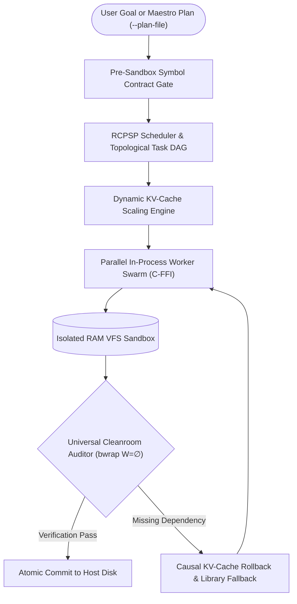

<div align="center">

# ⚡ OMNI ENGINE
### **Sovereign, In-Process Autonomous Software Engineering Runtime**
*100% Offline • Zero Cloud Subscriptions • Direct In-Process C-FFI • Deterministic Cleanroom Sandboxing*

[](https://www.rust-lang.org)
[](https://github.com/ielfeqi-rgb/omni_engine)
[-blue.svg?logo=github)](https://github.com/ielfeqi-rgb/omni_engine/releases/tag/v2.1.2)
[](https://github.com/ielfeqi-rgb/omni_engine/actions)
[-purple.svg)]()
[]()
[](LICENSE)

<br/>

[**About**](#-about-omni-engine) • 
[**What's New in v2.1.2**](#-whats-new-in-v212) • 
[**Core Architecture**](#-core-architectural-pillars) • 
[**Quickstart**](#-quickstart) • 
[**CLI Reference**](#-cli-reference--usage) • 
[**Maestro Protocol**](#-decoupled-maestro-protocol) • 
[**OpenAI API**](#-openai-compatible-api--web-ui) • 
[**Agent Guide**](AGENTS.md)

</div>

---

## 📖 About Omni Engine

**Omni Engine** is an open-source, sovereign, in-process autonomous software engineering runtime written in pure Rust. It transforms language models into deterministic, verified software compilers capable of generating, modifying, and testing multi-file software systems completely on-device without cloud dependencies.

Unlike conventional AI coding assistants that rely on streaming chat tokens from remote servers, Omni Engine operates as an **autonomous software synthesis swarm**:

1. **Deterministic Execution:** Code is planned, staged in an isolated in-memory Virtual File System (VFS), and verified inside an unprivileged Linux Bubblewrap (`bwrap`) cleanroom before any modifications touch the host disk.
2. **In-Process C-FFI Inference:** `llama.cpp` is linked directly in RAM via low-overhead C-FFI bindings, enabling microsecond token steering, causal KV-cache slicing, and rollback without socket latency or external daemons.
3. **Decoupled Architecture (v2.1.2):** High-capacity frontier LLMs (Claude 3.5 Sonnet, GPT-4o) or human architects act as **Maestros** by emitting mathematical DAG blueprints (`omni_plan.json`), while Omni Engine executes the plan locally on consumer CPU/GPU hardware with dynamic KV-cache scaling and automated symbol contract enforcement.
4. **Surgical Refactoring (Zero-Wipe Invariant):** When refactoring existing repositories, the engine locks AST symbol tables and only permits surgical line diffs (`+lines / -0 regressions`), preventing models from erasing functional code.

---

## 🚀 What's New in v2.1.2 ("LLM's Compatibility Update")

Omni Engine v2.1.2 introduces the **Decoupled Maestro Architectural Protocol**, unlocking full compatibility between frontier cloud models and local execution:

* **Maestro Plan Protocol (`--plan-file`)**: Direct ingestion of structured multi-file DAG blueprints (`omni_plan.json`), decoupling high-level architectural planning from local execution.
* **Pre-Sandbox Symbol Contract Gate**: Static AST verification that guarantees mandatory classes, types, and functions are declared in RAM before running sandbox tests, eliminating downstream import cascades.
* **Anti-Redeclaration Guard**: Worker prompt isolation that prevents downstream tasks from redeclaring upstream data structures or colliding with parent namespaces.
* **Dynamic KV-Cache Context Scaling**: Adaptive memory allocation scaling context from 4,096 to 16,384 tokens based on dependency graph depth, ensuring complex multi-file DAGs execute with zero context crashes.
* **Autonomous Contract Distillation**: Large dependency interfaces are distilled into concise type schemas (under 40 lines / 1.2 KB), preventing attention dilution while preserving symbol contracts.

See the complete [v2.1.2 Release Notes](docs/OMNI_2.1.2_RELEASE_NOTES.md) for detailed technical specifications.

---

## 🧠 Core Architectural Pillars



### 1. In-Process C-FFI Inference (`llama.cpp`)
Omni Engine eliminates the latency and serialization overhead of HTTP daemons and Python runtimes. Upstream `llama.cpp` is directly linked into the compiled Rust binary, enabling microsecond token steering, custom sampling, and thread-safe context control.

### 2. Universal Cleanroom Sandboxing (`bwrap`)
Untrusted or candidate code never executes on the host filesystem directly. All file operations and test runs are contained within an unprivileged Linux Bubblewrap (`bwrap --unshare-all`) sandbox with read-only host mounts and an isolated RAM `/workspace`.

### 3. Causal DAG & $O(1)$ KV-Cache Slicing
When a worker encounters syntax or dependency errors, the engine does not discard context and restart from zero. It executes atomic KV-cache slicing (`kv_cache_seq_rm`), excising failed generation turns in **~6 milliseconds** while preserving established upstream context.

### 4. Zero-Wipe Invariant (`omni_engine modify`)
During codebase modification or refactoring, Omni Engine preloads the host repository into RAM VFS and locks the AST symbol table. Only surgical additive or replacement diffs are accepted; total file wipes and regression erasures are rejected at the compiler level.

### 5. Sovereign Resource Efficiency
Engineered to operate with high efficiency on modern multi-core CPUs and consumer hardware:
* Peak RAM RSS footprint: **~1.87 GB** with 1.5B Q4_K_M models.
* Dynamic KV-cache expansion up to 16,384 tokens when handling deep multi-module dependency trees.
* Hardware-agnostic: Seamlessly leverages GPU acceleration (CUDA, Metal, Vulkan, ROCm) via upstream dynamic libraries without Rust code modification.

---

## ⚡ Quickstart

### Method 1: Download Pre-Built Linux Binary (v2.1.2)

```bash
# 1. Download release tarball
wget https://github.com/ielfeqi-rgb/omni_engine/releases/download/v2.1.2/omni_engine_v2.1.2_linux_x86_64.tar.gz

# 2. Extract binary and runtime libraries
tar -xzvf omni_engine_v2.1.2_linux_x86_64.tar.gz
cd omni_engine_v2.1.2_linux_x86_64

# 3. Download recommended default coding model (~1.1 GB)
./bin/omni_engine download --qwen

# 4. Verify installation
./bin/omni_engine status
```

### Method 2: Build from Source

```bash
# Clone the repository
git clone https://github.com/ielfeqi-rgb/omni_engine.git
cd omni_engine

# Install system dependencies (Linux)
sudo apt update && sudo apt install -y build-essential cmake clang libssl-dev bubblewrap

# Build release binary
cargo build --release

# Run unit and invariant test suite
LD_LIBRARY_PATH="$(pwd)/bin" cargo test --lib
```

---

## 🛠️ CLI Reference & Usage

Omni Engine offers a comprehensive CLI for generation, refactoring, model management, and interactive interfaces:

| Command | Description | Example |
| :--- | :--- | :--- |
| `run <goal>` | Synthesizes a new multi-file software system from scratch | `omni_engine run "Build a REST API with SQLite" --review --output-dir ./api` |
| `run --plan-file <file>` | Executes an architectural blueprint via Maestro Protocol | `omni_engine run --plan-file ./examples/maestro_plan.json --output-dir ./out` |
| `modify <goal>` | Refactors an existing project with Zero-Wipe Invariant | `omni_engine modify "Add JWT authentication" --dir ./api --output-dir ./api` |
| `download` | Downloads and verifies GGUF models directly | `omni_engine download --qwen` |
| `models` | Lists discovered local models and memory footprints | `omni_engine models` |
| `tui` | Launches full-screen graphical Terminal Dashboard | `omni_engine tui` |
| `serve` | Starts OpenAI-compatible HTTP proxy & Web Dashboard | `omni_engine serve --port 8090` |
| `console` | Launches interactive REPL console (`omni❯`) | `omni_engine console` |
| `status` | Reports CPU threads, RAM RSS buffer, and hardware stats | `omni_engine status` |

---

## 🎼 Decoupled Maestro Protocol

Omni Engine allows external frontier LLMs (such as Claude 3.5 Sonnet, GPT-4o, or Gemini 1.5 Pro) or software architects to specify system blueprints in structured JSON:

```json
{
  "project_name": "TaskFlow",
  "concurrency_limit": 4,
  "nodes": [
    {
      "id": 1,
      "kind": "CREATE",
      "target_file": "models.py",
      "depends_on": [],
      "description": "Define Task and Priority data models",
      "symbols": ["class Task", "class Priority"],
      "invariants": ["Zero external dependencies"]
    },
    {
      "id": 2,
      "kind": "CREATE",
      "target_file": "storage.py",
      "depends_on": [1],
      "description": "Implement JSON file storage repository",
      "imports": ["from models import Task, Priority"],
      "symbols": ["class StorageRepository", "def save_tasks", "def load_tasks"],
      "invariants": ["Atomic file writes"]
    }
  ]
}
```

Execution is invoked with a single command:
```bash
omni_engine run --plan-file ./examples/maestro_plan.json --output-dir ./taskflow
```

The engine validates dependencies, allocates thread workers, enforces symbol presence, verifies code in Bubblewrap sandboxes, and commits the cleanroom deliverables to disk.

---

## 🌐 OpenAI-Compatible API & Toolchain Integration

Omni Engine provides a 100% sovereign, drop-in replacement for OpenAI in your existing developer tools (Cursor, Continue.dev, Cline, Aider, or custom SDK scripts):

```bash
# Launch server on port 8090
omni_engine serve --port 8090
```

* **Web UI Dashboard:** Navigate to `http://127.0.0.1:8090` to monitor telemetry, inspect models, and interact with the engine.
* **API Key Generation:**
  ```bash
  omni_engine keys new "Local-Developer"
  # Output: omni_sk_...
  ```
* **Endpoint URL:** `http://127.0.0.1:8090/v1/chat/completions`

---

## 🛡️ Sandbox Security Architecture

Omni Engine uses Linux Bubblewrap (`bwrap`) to enforce strict unprivileged namespace and filesystem isolation:

1. **Read-Only Host Mounts:** Host system roots (`/usr`, `/lib`, `/bin`) are mounted strictly read-only.
2. **Network Isolation:** All networking namespaces are unshared (`--unshare-all`). Sandboxed processes cannot perform outbound connections or network calls.
3. **Ephemeral Staging:** Deliverables are generated and compiled inside an isolated RAM tmpfs (`/workspace`). Host files are only updated after cleanroom verification passes.
4. **TTY Detachment:** Commands execute with `--new-session` (`setsid()`), eliminating `TIOCSTI` terminal injection vulnerabilities.
5. **Path Traversal Defense:** VFS commits reject directory escapes, intermediate symlinks, and absolute path traversal attacks.

---

## 📄 License

Omni Engine is licensed under the [MIT License](LICENSE).
