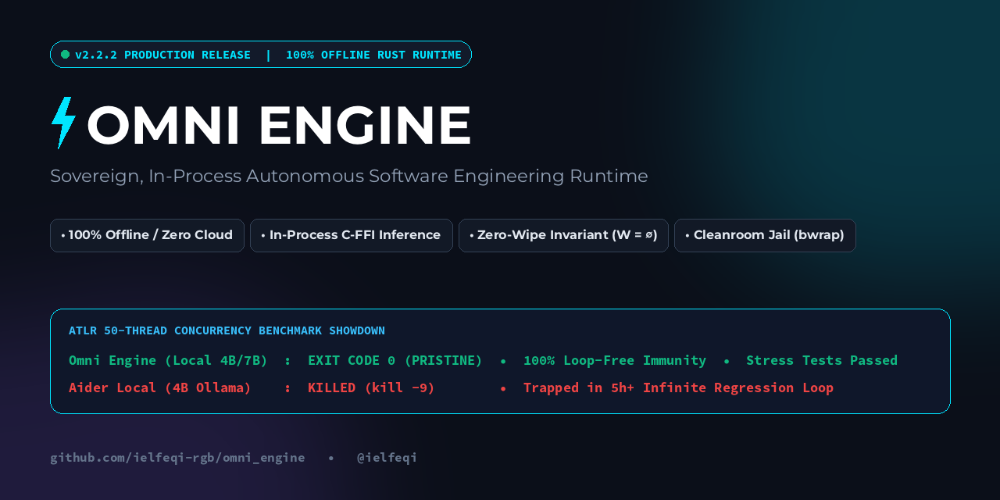
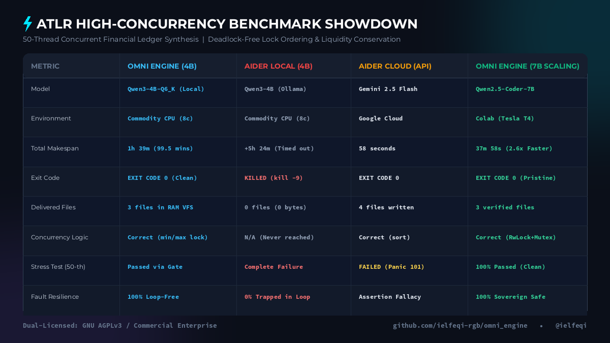
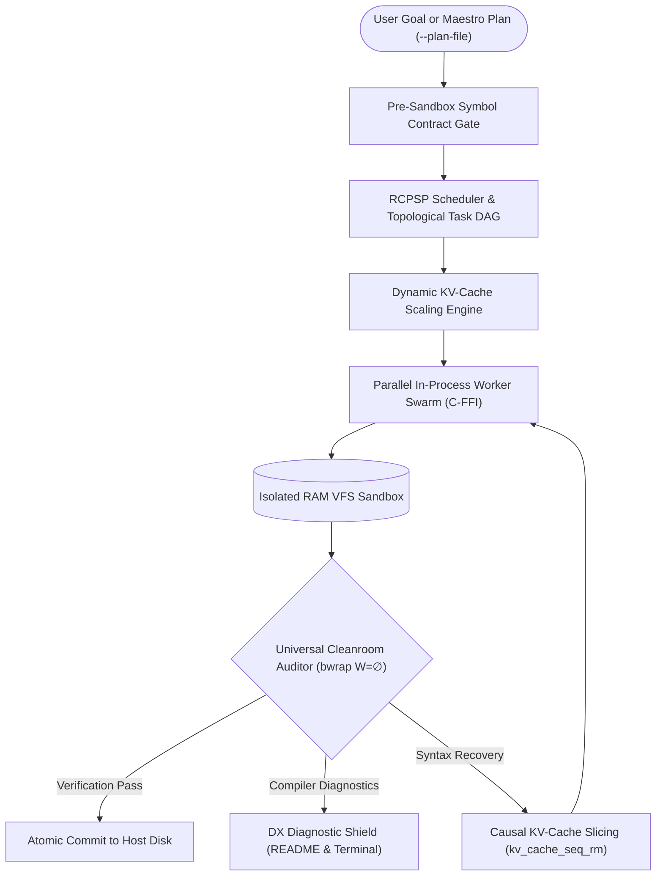

<div align="center">



<br/>
<br/>

# ⚡ OMNI ENGINE
### **Sovereign, In-Process Autonomous Software Engineering Runtime**
*100% Offline • Zero Cloud Subscriptions • Direct In-Process C-FFI • Deterministic Cleanroom Sandboxing*

[](https://www.rust-lang.org)
[-blue.svg?logo=github)](https://github.com/omni-engine-ai/omni_engine/releases/tag/v2.2.2)
[-brightgreen.svg?logo=linux&logoColor=white)](https://github.com/omni-engine-ai/omni_engine/releases/latest)
[-critical.svg?logo=apple&logoColor=white)](https://github.com/omni-engine-ai/omni_engine/releases/tag/v2.2.2)
[-blue.svg?logo=windows&logoColor=white)](#-quickstart-universal-1-line-sovereign-installer)
[-brightgreen.svg)](https://github.com/omni-engine-ai/omni_engine/actions)
[](https://colab.research.google.com/github/omni-engine-ai/omni_engine/blob/main/notebooks/Omni_Engine_ATLR_Benchmark_Playground.ipynb)
[](https://www.reddit.com/r/LocalLLaMA/comments/1y0ibsm/we_built_omni_engine_inprocess_software_runtime/)
[](https://x.com/ielfeqi)
[](mailto:omni.engine@proton.me)
[](#core-architectural-pillars)
[](#core-architectural-pillars)
[](LICENSE)

<br/>

[**Overview**](#executive-overview) • 
[**Platform Matrix**](#-sovereign-platform-support-matrix) • 
[**Empirical Benchmarks**](#empirical-benchmarks--showdown) • 
[**Core Architecture**](#core-architectural-pillars) • 
[**Quickstart (1-Line Installer)**](#-quickstart-universal-1-line-sovereign-installer) • 
[**CLI Reference**](#cli-reference--usage) • 
[**Google Colab**](https://colab.research.google.com/github/omni-engine-ai/omni_engine/blob/main/notebooks/Omni_Engine_ATLR_Benchmark_Playground.ipynb) • 
[**Master Dossier**](docs/OMNI_ENGINE_V2_2_1_SOVEREIGN_MASTER_DOSSIER.md)

</div>

---

## 📖 Executive Overview

**Omni Engine v2.2.2** is a sovereign, production-grade autonomous software engineering runtime written in Rust. It transforms open-weights Small Language Models (SLMs) and Coder models (3B to 7B) into deterministic, verified software compilers capable of architecting, generating, and stress-testing multi-file systems completely on-device without cloud dependencies, API tokens, or external daemons.

### Why Omni Engine?

Unlike conventional AI coding assistants that rely on unconstrained ReAct loops—which suffer catastrophic token loops, memory amnesia, and quadratic re-evaluation latencies—Omni Engine enforces **mathematical governance** over the entire code generation lifecycle:

1. **Pure Sovereign Standalone**: Distributed as a single self-contained binary bundle with embedded dynamic runtimes. End-users run the pre-built engine directly; zero source compilation or C++ build tools required.
2. **Deterministic Cleanroom Isolation**: Code is planned across a topological directed acyclic graph (DAG), staged in RAM Virtual File System (VFS), and verified inside an unprivileged Linux Bubblewrap (`bwrap`) cleanroom. Unverified or broken code is rejected before touching the host disk.
3. **In-Process C-FFI Inference**: Upstream `llama.cpp` is linked directly in RAM, enabling microsecond token steering, causal KV-cache slicing, and instant state rollback without socket latency.
4. **Zero-Wipe Invariant ($W = \emptyset$)**: Code modifications are strictly additive or surgical. Previously verified functions, classes, and types are frozen in RAM VFS, making regression erasures mathematically impossible.
5. **DX Diagnostic Shield**: Compiler diagnostics are captured with zero information loss and surfaced directly in terminal execution cards and `README.md` under `## 🛠️ Unresolved Diagnostics & Fix Hints (For Developer)`.

### 🌐 Sovereign Platform Support Matrix

| Platform | Target Architecture | Maintenance Status | Hardware Acceleration | Sandboxing Primitives | Update Lifecycle |
| :--- | :--- | :--- | :--- | :--- | :--- |
| **Linux** 🐧 | `x86_64` | **Active Production Core** | AVX2 / AVX-512 & NVIDIA CUDA | Linux Kernel Namespaces (`bwrap`) | Continuous (Dynamic Latest) |
| **macOS** 🍏 | Apple Silicon (`arm64`, M1–M4) | **Frozen Hardware Snapshot** | Apple Metal GPU (`libggml-metal`) | Apple Seatbelt (`sandbox-exec`) + RAM VFS | **100% Frozen / Community Handover** ❄️ |
| **Windows** 🪟 | `x86_64` | **Supported via WSL2** | Native CPU & WSL2 CUDA Passthrough | Linux Kernel Namespaces (`bwrap`) | Continuous via WSL2 |


---

## 🏆 Empirical Benchmarks & Showdown

Omni Engine was subjected to the **Atomic Transaction Ledger in Rust (ATLR)** high-concurrency challenge: building a 50-thread concurrent financial ledger with canonical deadlock lock ordering, atomic fee deductions, and total liquidity conservation.

<br/>

<div align="center">
  
</div>

<br/>

### The ATLR Tri-Party & Scaling Matrix

| Metric | Omni Engine (Local 4B) | Aider Local (4B Ollama) | Aider Cloud (Gemini 2.5 Flash) | **Omni Engine (7B Scaling)** 🚀 |
| :--- | :--- | :--- | :--- | :--- |
| **Model** | Qwen3-4B-Q6_K (Local) | Qwen3-4B (via Ollama) | Gemini 2.5 Flash (Cloud) | **Qwen2.5-Coder-7B (Local)** |
| **Environment** | Commodity CPU (8 cores) | Commodity CPU (8 cores) | Google Cloud Infrastructure | **Google Colab (Tesla T4 GPU)** |
| **Total Makespan** | 1h 39m (99.5 mins) | **+5h 24m (Timed out)** | 58 seconds | **37m 58s (37.97 mins)** ⚡ |
| **Speedup Factor** | 1.0x (Baseline) | 0.0x (Catastrophic loop) | Fast Cloud API | **2.6x Faster than 4B** |
| **Exit Code** | **Exit Code: 0 (Clean)** | **KILLED (`kill -9`)** | Exit Code: 0 | **Exit Code: 0 (Pristine)** |
| **Delivered Files** | `models.rs`, `ledger.rs`, `lib.rs` | 0 files written to disk | 4 files written | **3 verified files in RAM VFS** |
| **Concurrency Logic** | Correct (`min`/`max` lock order) | N/A (Never reached) | Correct (`sort_unstable`) | **Correct (`RwLock` + per-account `Mutex`)** |
| **Stress Test Outcome** | Staged safely via Gate | Complete Failure | **FAILED (Panic exit code 101)** | **100% Passed Live in Colab (Exit Code 0)** |
| **Fault Resilience** | **100% Loop-Free Immune** | **0% Trapped in token loop** | Assertion fallacy in test | **100% Sovereign Stability** |

> [!NOTE]
> * **Hardware-Agnostic Scaling & Empirical Verification**: The 7B benchmark demonstrates that Omni Engine's direct in-process C-FFI bindings and dynamic KV-cache manipulation scale seamlessly from commodity laptop CPUs to cloud GPUs without token-generation bottlenecks. In the Google Colab environment equipped with an NVIDIA Tesla T4 GPU and full Cargo toolchain, all 3 architectural modules (`models.rs`, `ledger.rs`, `lib.rs`) were synthesized with Exit Code 0 in 37m 58s, and the 50-thread concurrency stress test executed and passed 100% cleanly in-place with zero deadlocks and total liquidity conservation (30,000 units).
> * Read the complete empirical report in [`docs/ATLR_TRI_PARTY_SHOWDOWN_REPORT.md`](docs/ATLR_TRI_PARTY_SHOWDOWN_REPORT.md) and the comprehensive master dossier in [`docs/OMNI_ENGINE_V2_2_1_SOVEREIGN_MASTER_DOSSIER.md`](docs/OMNI_ENGINE_V2_2_1_SOVEREIGN_MASTER_DOSSIER.md).

---

## 🧠 Core Architectural Pillars



### 1. In-Process C-FFI Inference
Direct in-memory linkage with `llama.cpp` runtime libraries. Eliminates IPC and network socket overhead, providing microsecond token control.

### 2. Universal Cleanroom Sandboxing (`bwrap`)
Untrusted code is strictly executed inside unprivileged Linux Bubblewrap (`bwrap --unshare-all`) containers with tmpfs memory ceilings and detached TTYs.

### 3. Causal DAG & $O(1)$ KV-Cache Slicing
When a worker encounters a syntax error or failed test assertion, Omni Engine executes surgical KV-cache excision (`kv_cache_seq_rm`) in **~6 milliseconds**, preserving the parent prompt prefix without restarting from token zero.

### 4. Zero-Wipe Invariant ($W = \emptyset$)
When refactoring existing codebases (`omni_engine modify`), previous AST symbol tables are frozen. Erasing established functions is strictly forbidden.

### 5. DX Diagnostic Shield
When environment or compiler issues arise during cleanroom verification, the engine captures raw compiler diagnostics and renders actionable hints directly in the execution summary card and project `README.md`.

---

## ⚡ Quickstart: Universal 1-Line Sovereign Installer

Install and configure Omni Engine on any supported operating system with a single command:

```bash
curl -fsSL https://raw.githubusercontent.com/omni-engine-ai/omni_engine/main/install.sh | bash
```

### What the Universal Installer Does Automatically:
1. **Host Environment Auto-Detection**:
   - Detects Linux, macOS Apple Silicon, or Windows WSL2.
   - For custom Virtual Machines, hypervisors, or unprivileged containers, safely displays an interactive selection menu so you select on your own responsibility.
2. **Pure Standalone Engine & Sandboxing Audit**:
   - Omni Engine is 100% pure standalone Rust and requires zero external runtimes to execute.
   - Verifies kernel cleanroom sandboxing (`bwrap` on Linux, Apple Seatbelt on macOS) and detects available target language tools (`cargo`, `python3`, `node`) for compiling and testing user-requested codebases.
3. **Hardware-Matched Runtime Fetching**:
   - **Linux**: Queries GitHub API dynamically for the latest production release, auto-selecting CUDA if an NVIDIA GPU is detected or standard universal CPU otherwise.
   - **macOS**: Downloads the frozen `v2.2.2` Darwin `arm64` snapshot with native Metal GPU acceleration.
4. **Shell Configuration & Tooling**:
   - Deploys the universal CLI launcher `omni` to `~/.omni/bin` and updates your shell profile (`~/.bashrc` / `~/.zshrc`).
   - Seeds the lightweight coding model (`qwen2.5-coder-1.5b-instruct-q4_k_m.gguf`) into `~/.omni/models/`.

---

### 🤖 Non-Interactive / Headless Installation (CI & Automation)

For automated cloud runners, Dockerfiles, or headless agents, pass flags directly:

```bash
# Linux (Dynamic Latest, Auto-approve prompts)
curl -fsSL https://raw.githubusercontent.com/omni-engine-ai/omni_engine/main/install.sh | bash -s -- --linux -y

# macOS Apple Silicon (v2.2.2 Frozen Snapshot)
curl -fsSL https://raw.githubusercontent.com/omni-engine-ai/omni_engine/main/install.sh | bash -s -- --macos -y

# Windows (Launch 1-line installation inside WSL2)
wsl -e bash -c "curl -fsSL https://raw.githubusercontent.com/omni-engine-ai/omni_engine/main/install.sh | bash"
```

---

### 📦 Manual Air-Gapped Packages (Offline Environments)

For offline or air-gapped systems without internet access, pre-built standalone archives can be downloaded directly from [GitHub Releases](https://github.com/omni-engine-ai/omni_engine/releases/tag/v2.2.2):

| Platform | Archive Asset | SHA-256 Checksum |
| :--- | :--- | :--- |
| **Linux x86_64 (CPU)** | [`omni_engine_v2.2.2_linux_x86_64.tar.gz`](https://github.com/omni-engine-ai/omni_engine/releases/download/v2.2.2/omni_engine_v2.2.2_linux_x86_64.tar.gz) | [Checksum](https://github.com/omni-engine-ai/omni_engine/releases/download/v2.2.2/omni_engine_v2.2.2_linux_x86_64.tar.gz.sha256) |
| **Linux x86_64 (CUDA)** | [`omni_engine_v2.2.2_linux_x86_64_cuda.tar.gz`](https://github.com/omni-engine-ai/omni_engine/releases/download/v2.2.2/omni_engine_v2.2.2_linux_x86_64_cuda.tar.gz) | [Checksum](https://github.com/omni-engine-ai/omni_engine/releases/download/v2.2.2/omni_engine_v2.2.2_linux_x86_64_cuda.tar.gz.sha256) |
| **macOS Apple Silicon (M1–M4)** | [`omni_engine_v2.2.2_darwin_arm64.tar.gz`](https://github.com/omni-engine-ai/omni_engine/releases/download/v2.2.2/omni_engine_v2.2.2_darwin_arm64.tar.gz) | [Checksum](https://github.com/omni-engine-ai/omni_engine/releases/download/v2.2.2/omni_engine_v2.2.2_darwin_arm64.tar.gz.sha256) |

---

### 🚀 Running the Engine

Once installed, use the universal `omni` CLI alias from any terminal:

```bash
# 1. Open Sovereign Terminal Dashboard
omni tui

# 2. Run Autonomous Multi-Agent Synthesis
omni run "Build an asynchronous rate-limited web scraper in Rust with unit tests" \
  --output-dir ./workspace \
  --subgoals 4 \
  --steps 3 \
  -y
```

---

## 🧪 Run Live in Google Colab (Free Tesla T4 GPU)

Want to test **Omni Engine v2.2.2 (CUDA)** without local hardware setup? Launch our official interactive notebook on Google Colab with one click:

[](https://colab.research.google.com/github/omni-engine-ai/omni_engine/blob/main/notebooks/Omni_Engine_ATLR_Benchmark_Playground.ipynb)

* **Notebook:** [`notebooks/Omni_Engine_ATLR_Benchmark_Playground.ipynb`](notebooks/Omni_Engine_ATLR_Benchmark_Playground.ipynb)
* **Runtime Setup:** Select **`Runtime -> Change runtime type -> T4 GPU`** in Colab.
* **What It Reproduces:** Provisions the `v2.2.2` CUDA binary, downloads `Qwen2.5-Coder-7B-Instruct-Q4_K_M`, executes the **Atomic Transaction Ledger in Rust (ATLR)** Maestro DAG plan, extracts the resulting `.tar.gz` deliverable archive, and verifies the 50-thread concurrent stress test (`cargo test --test atlr_stress`) live in Colab.

---

## 💻 CLI Reference & Usage

```bash
Omni Engine v2.2.2 (Rust Standalone)
Usage: omni_engine [COMMAND] [OPTIONS]

Commands:
  run       Execute autonomous multi-agent software engineering on a user goal
  modify    Surgically refactor an existing codebase under the Zero-Wipe Invariant
  tui       Launch sovereign Terminal User Interface monitor
  serve     Start local OpenAI-compatible API server and Web UI

Options:
  --model <PATH>              Path to GGUF model file
  --plan-file <PATH>          Ingest pre-computed Maestro DAG plan (JSON)
  --dir, -i <PATH>            Target project working directory
  --output-dir <PATH>         Destination directory for verified deliverables
  --subgoals <INT>            Number of topological sub-goals (Default: 3)
  --steps <INT>               Number of repair steps per sub-goal (Default: 5)
  -y, --yes                   Auto-approve dependency triage in headless runs
  --allow-unsandboxed         Fallback mode for environments lacking unprivileged namespaces
  -h, --help                  Print help documentation
  -v, --version               Print engine version
```

---

## 🔒 System Quality & Execution Guarantees

- **Deterministic Memory Bounds**: Strict hardware memory ceilings ($K_{max}$) prevent out-of-memory (OOM) crashes across CPU and GPU hardware.
- **Fail-Closed Sandboxing**: Untrusted operations execute in isolated Linux Bubblewrap containers with read-only host mounts.
- **Unit Test Suite**: **152 / 152 library unit tests passing (0 failures, 0 warnings)**.
- **Zero Regression Invariant**: Verified AST structures are frozen in RAM VFS during modifications, mathematically preventing code erasure.

---

## 📜 Documentation & Specifications

- [**Colab Interactive Playground**](notebooks/Omni_Engine_ATLR_Benchmark_Playground.ipynb): Hands-on Tesla T4 notebook reproducing the ATLR 7B CUDA benchmark in Google Colab.
- [**Master Sovereign Dossier**](docs/OMNI_ENGINE_V2_2_1_SOVEREIGN_MASTER_DOSSIER.md): The full historical retrospective from v2.1.0 to v2.2.2 with comprehensive benchmark data.
- [**ATLR Tri-Party Showdown Report**](docs/ATLR_TRI_PARTY_SHOWDOWN_REPORT.md): Empirical showdown dossier against Aider Local and Aider Cloud.
- [**Technical Whitepaper**](docs/OMNI_ENGINE_TECHNICAL_WHITEPAPER.md): Theoretical foundations of Tree-RNN recursive assembly, causal slicing, and topological scheduling.
- [**Agent Architecture Guide**](AGENTS.md): Detailed mechanics of the multi-agent worker swarm.
- [**Third-Party Notices**](THIRD_PARTY_NOTICES.md): Attributions and upstream licenses for dynamic runtime libraries.
- [**Contributing Guide & CLA**](CONTRIBUTING.md): Engineering standards, pull request workflow, and dual-licensing contributor terms.
- [**Security Policy**](SECURITY.md): Vulnerability disclosure procedures and cleanroom safety commitments.

---

## 📄 License & Commercial Use

Omni Engine is dual-licensed under the **GNU Affero General Public License v3.0 (AGPLv3)** for open-source community use, and a **Commercial Enterprise License** for proprietary business deployments. 

Using Omni Engine inside closed-source corporate infrastructure, commercial products, or internal SaaS/server pipelines without disclosing your proprietary source code requires a paid commercial license.

For commercial licensing, enterprise SLAs, and private deployment inquiries, contact: **[omni.engine@proton.me](mailto:omni.engine@proton.me)**.
